# Fitted

**Phone photos in. A fitted, print-ready prosthetic hand out.**

By **Nicole Ma, Danica Sun and Shriya Sreeju** · [Pitch deck (PDF)](docs/pitch/Fitted-pitch-deck.pdf)

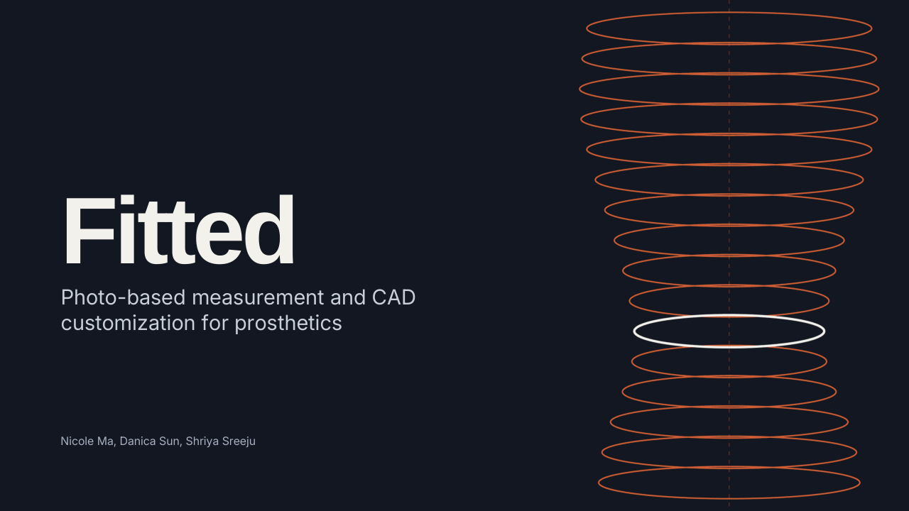

Fitted turns a few phone photos (or a LiDAR scan) of a child's arm into an [e-NABLE](https://enablingthefuture.org/) hand that is sized to their width *and* their length, with a gauntlet shaped to their actual forearm. A volunteer reviews and approves every design before anything is printed.

Built for the e-NABLE community. Fitted is not affiliated with e-NABLE and is not a medical device.

---

## Why

About 40,000 e-NABLE volunteers in 100+ countries 3D-print free hands and arms. Printing is easy; **fitting** is the bottleneck:

- **Every e-NABLE sizing method ends in one scale percentage.** The stock hand is stretched evenly, usually from knuckle width plus 5 mm. Real hands differ in proportion, not just size, so one number can't get both width and length right.
- **Gauntlets are fitted by hand,** by heat-forming plastic over the arm or a plaster cast.
- **A 2–3 mm error changes the fit,** and a misfit means printing the whole device again.

Women already get less from prosthetic care: in clinical (lower-limb) studies they wait longer for a first prosthesis and are under-represented in prosthetics research. Fitted sizes width and length separately from each person's own measurements, checks every design against the 1,986 women in ANSUR II, and reports accuracy for women separately.

## How it works

| Step | Who | What happens |
|---|---|---|
| 1. Read and straighten the photos | Code | Finds the four ArUco markers on the printed sheet, removes perspective and converts pixels to true millimetres |
| 2. Check the photos | Claude | Rejects blurry, dark, swapped or off-sheet photos with plain-language retake instructions |
| 3. Measure the arm | Code | Segments the arm, finds the wrist, measures width and thickness along it, corrects for camera height, and builds a 3D limb model |
| 4. Size the hand and plan the device | Code + Claude | Separate width and length scales for the Paraglider hand, from the person's other hand; Claude checks the plan against e-NABLE guidance |
| 5. Design the look | Claude | Turns "purple with stars" or a reference image into part colors (from real filament) and a raised gauntlet pattern |
| 6. Generate the parts | Code | Renders the Paraglider palm and fingers in OpenSCAD (WebAssembly); builds the gauntlet from the arm surface with a slip-on opening and strap slots; makes a 15-minute fit-test ring |
| 7. Check printability | Code | Watertightness, wall thickness, overhangs, bed fit, print-time and filament estimates; packs build plates and exports colored 3MF files |
| 8. Write the build guide | Claude | Parts list, print settings, assembly steps, a fit checklist and a plain-language summary for the family |
| Approve | Volunteer | Nothing is marked ready to print until a volunteer signs off |

Claude makes judgement calls; every millimetre comes from code. Claude only sees photos, renders and numbers, never raw scans. LiDAR mode (OBJ, STL, PLY or GLB from apps like Polycam or Scaniverse) replaces steps 1–3 with scan cleanup and slicing.

## Quick start

**Requirements:** Python 3 (tested with 3.14) and Node.js (tested with 26). An Anthropic API key is optional: without one, the Claude steps are skipped or fall back to simpler code, and the app tells you which.

```bash
cd backend
python3 -m venv .venv
.venv/bin/pip install -r requirements.txt
(cd scad && npm install)
```

Optionally add your API key to a `.env` file in the repository root (it's git-ignored):

```bash
echo "ANTHROPIC_API_KEY=your-key-here" > ../.env
```

Start the server from `backend/`:

```bash
.venv/bin/uvicorn app.main:app --port 8000
```

Then open http://localhost:8000. The FastAPI server also serves the frontend.

### Taking the photos

1. Print the marker sheet from http://localhost:8000/api/marker-sheet (add `?paper=a4` for A4). Print at 100% scale.
2. **Photo A:** the affected arm from above, forearm and hand flat on the sheet, palm down.
3. **Photo B:** the same arm resting on its side, thumb up.
4. **Photo C:** the other (sound) hand flat on the sheet, fingers together.

Shoot from roughly 1 m with 2× zoom so the camera looks straight down. Tape measurements of the wrist and forearm are optional.

To try it without photos, use the synthetic sample in the app: a simulated 10-year-old with a partial hand, built from ANSUR II proportions.

### What you get

Per job, in `backend/data/jobs/<id>/`:

- `fit_ring.3mf`: a 15 mm slice of the gauntlet at its tightest point. Print this first.
- `kit.3mf`: every part, with colors set.
- One STL per part, plus build plates packed for your printer's bed size.
- `build_guide.md`: the volunteer build guide.
- `measurements.json`: the measured limb and sizing.
- `fitted_package.zip`: everything above in one download.

A sample job takes a few seconds without Claude, longer with it.

## Accuracy

`backend/scripts/benchmark.py` tests the full pipeline on **80 synthetic people** built from ANSUR II hand and arm measurements: 40 women and 40 men, half shrunk to child size, all six Fitzpatrick skin types, camera heights of 55–110 cm, and wide and 2× lenses. Results are in [`backend/benchmark/results.json`](backend/benchmark/results.json).

| Test | Result |
|---|---|
| Photo measurement, all dimensions | **0.78 mm** mean error, 91% within 2 mm, no failures |
| Women / men | 0.74 / 0.81 mm |
| Child-sized / adult | 0.58 / 0.98 mm |
| Skin types II–VI / type I | 0.61–0.80 / 1.13 mm |
| LiDAR (30 noisy scans with holes) | 0.47 mm, 100% within 2 mm |
| Without perspective correction | 1.67 mm |
| Without the side photo | 1.04 mm |
| Other hand (sizing reference) | 2.1 mm length, 1.8 mm width (width always reads high) |
| Device length, all 1,986 ANSUR II women | **10.4 mm with uniform scaling → 2.4 mm with Fitted**; within 3 mm: 16% → 75% |
| Device length, all 4,082 ANSUR II men | 19.8 mm → 4.6 mm |
| Claude photo check (24 photos) | Caught 20 of 20 bad photos; no false alarms on 4 good ones |

For context: the best published single-photo hand measurement is 3.80 mm on real people ([HandAnthro](https://arxiv.org/abs/2609.37855), 2026 preprint), and e-NABLE's AI HandSizer reports about 12 mm in its designer's tests.

**These are best-case numbers.** Rendered photos are cleaner than real ones, and "child-sized" means adult hands scaled to 70–88%, not real children's data. A study on real people, at least half of them women, is the next step.

To re-run it from `backend/`:

```bash
.venv/bin/python scripts/benchmark.py --n 80 --workers 6
```

Add `--claude` to include the photo-check test, which needs an API key.

## Repository layout

```
backend/
  app/
    main.py           FastAPI server and API routes; serves the frontend
    pipeline.py       Job runner for photo and LiDAR modes
    photo.py          Marker sheet, rectification, segmentation, width profiles
    lidar.py          Scan loading, cleanup, alignment and slicing
    limb.py           3D limb model
    sizing.py         Separate width/length scaling vs uniform; ANSUR II checks
    hand.py           Paraglider parts via OpenSCAD (WebAssembly, run through Node)
    gauntlet.py       Gauntlet shell, opening, strap slots, fit-test ring
    design.py         Filament colors and gauntlet motifs
    printability.py   Print checks, estimates, plate packing, 3MF export
    render.py         Renders for Claude and the viewer
    ai.py             Claude calls (photo check, device plan, design spec, build guide)
    synthetic.py      Synthetic arms, photos and scans for samples and tests
    data/ansur_hands.json   ANSUR II hand and arm columns
  scad/               OpenSCAD runner (Node) and patched Paraglider files
  samples/            Synthetic sample inputs with ground truth
  scripts/            build_ansur.py, make_samples.py, benchmark.py
  benchmark/          Benchmark results
frontend/             Single-page app with a three.js 3D viewer
docs/PITCH_STATS.md   Research notes and sources
PLAN.md               Project plan
```

## API

| Method | Path | Purpose |
|---|---|---|
| GET | `/api/meta` | App info: base hand, filaments, motifs, ANSUR summary |
| GET | `/api/marker-sheet?paper=letter\|a4&fmt=pdf\|png` | Printable marker sheet |
| POST | `/api/jobs` | Start a job: multipart `payload` JSON plus `top`, `side`, `sound`, `scan` and up to 4 `refs` |
| GET | `/api/jobs/{id}` | Job status, steps, measurements and files |
| GET | `/api/jobs/{id}/files/{name}` | Download an output file |
| POST | `/api/jobs/{id}/approve` | Volunteer sign-off: `{"name": "..."}` |

## Limitations

- **Not yet tested on real people.** All accuracy numbers come from synthetic data.
- **No real children's data.** ANSUR II covers U.S. Army adults, and no public 3D scans of partial-hand limbs exist.
- **Separately scaled joints need mechanical testing.** Width-to-length ratios are limited to 0.88–1.12 of the stock design.
- **Fit isn't just size.** Comfort, padding, cord tension and grip still need a volunteer and a fitting session.
- **Photos are processed on the server running Fitted.** Claude receives photos, renders and measurements, not raw scans. Job files stay in `backend/data/jobs/` until deleted.

## Pitch deck

The full deck is in [`docs/pitch/Fitted-pitch-deck.pdf`](docs/pitch/Fitted-pitch-deck.pdf).

<details>
<summary><b>View all slides</b></summary>

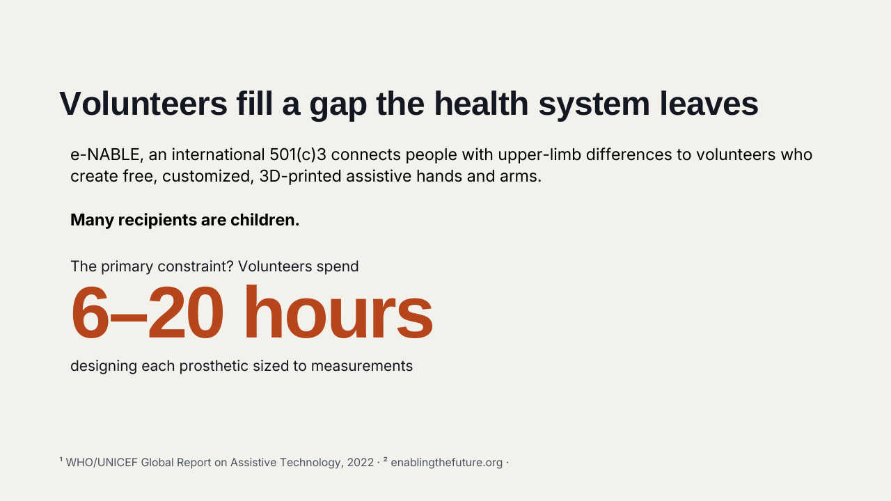
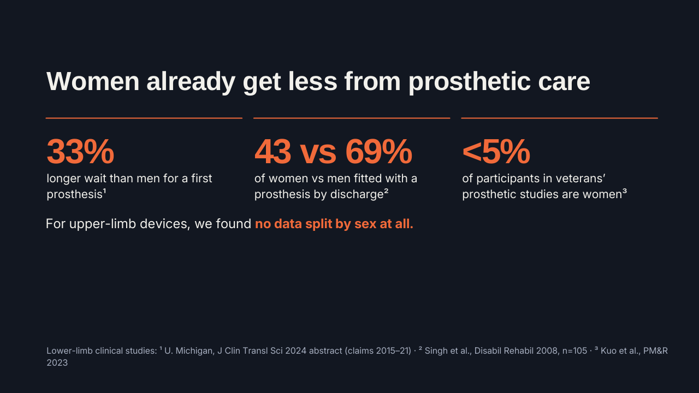
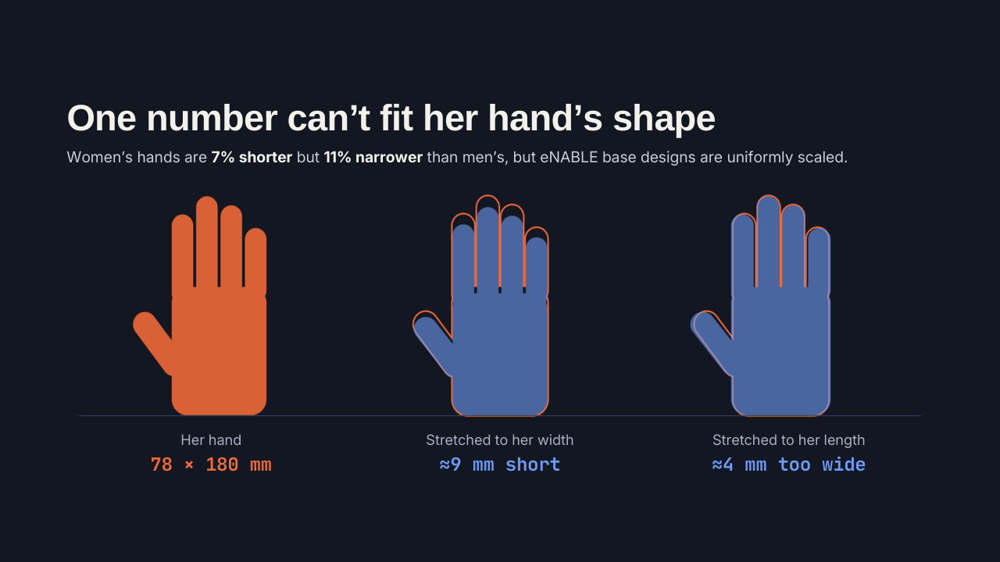
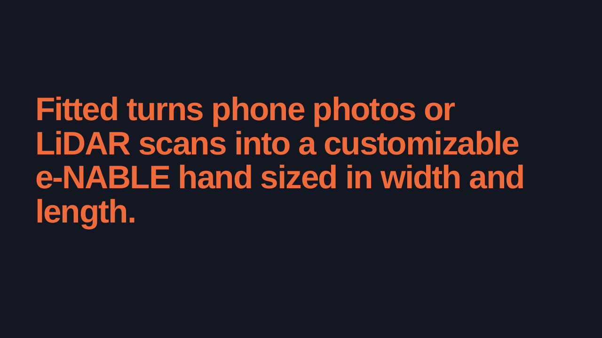
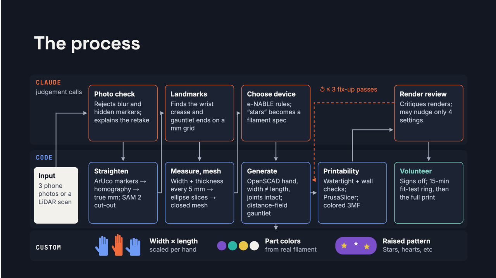
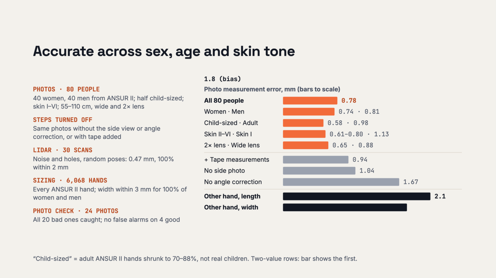
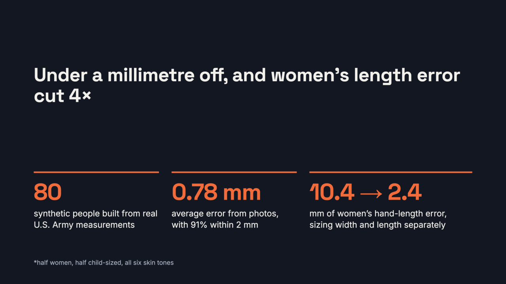
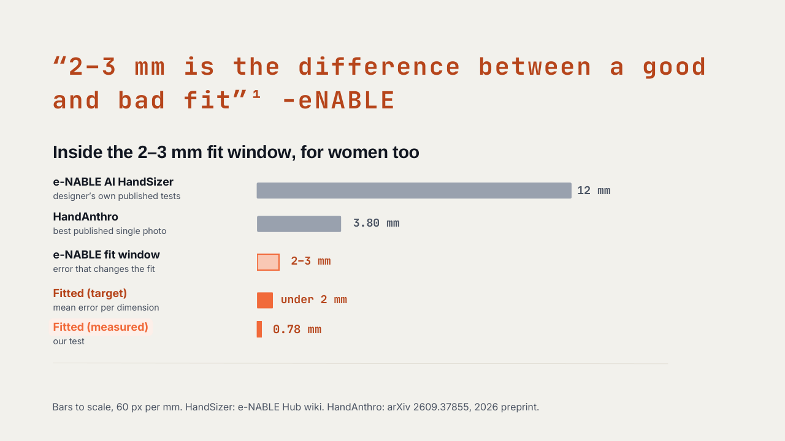
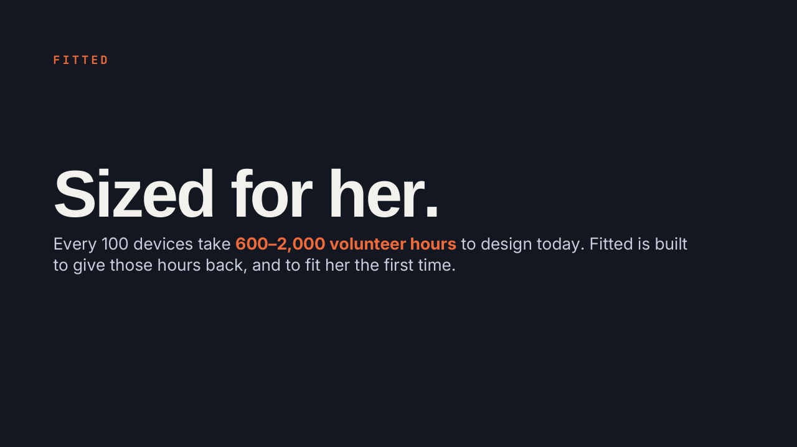
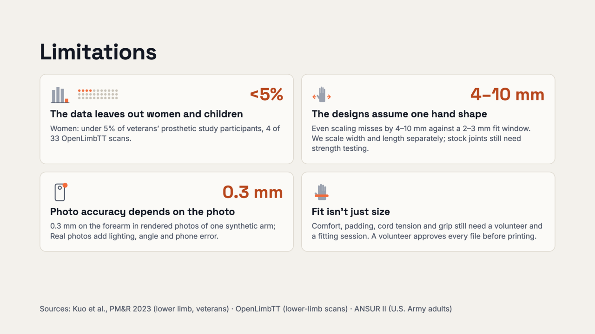
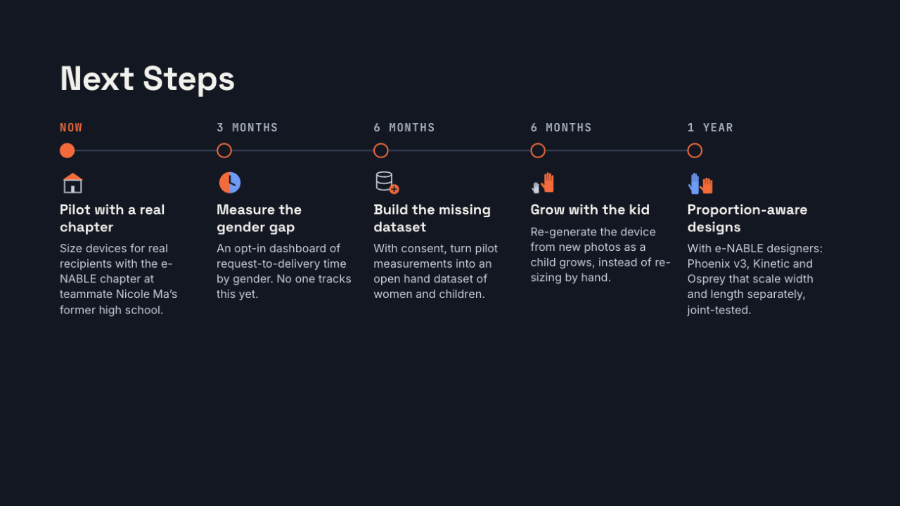
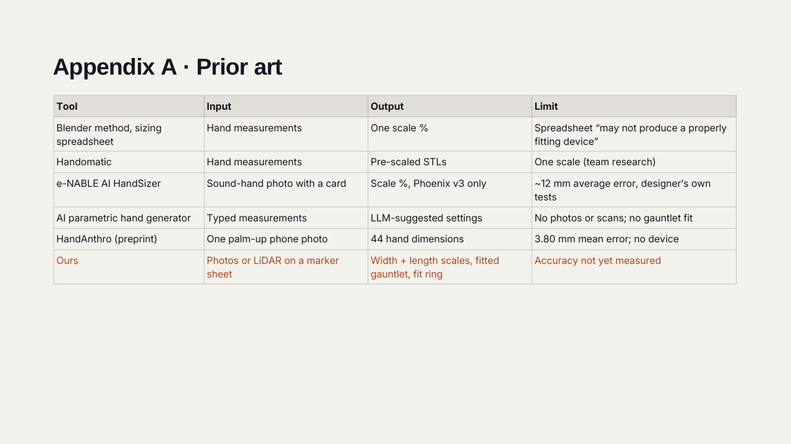
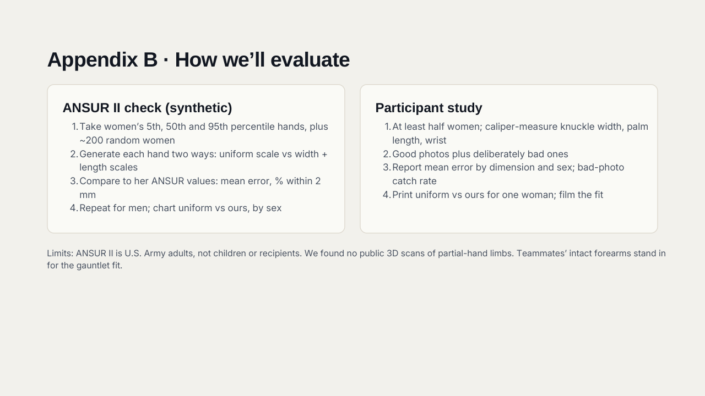
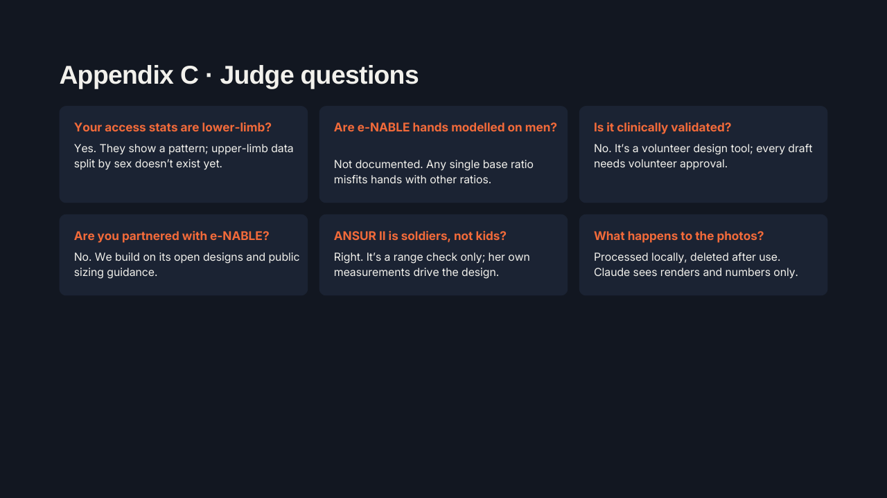
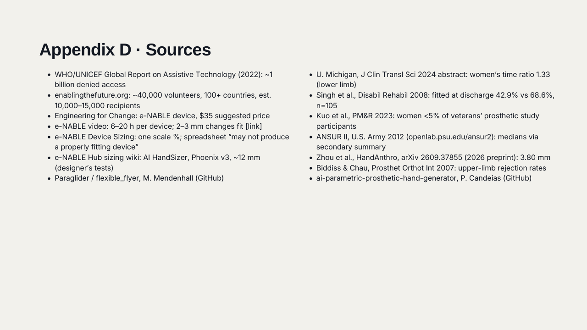

</details>

## Team

- **Nicole Ma** ([@nicolesplaining](https://github.com/nicolesplaining))
- **Danica Sun** ([@danicasun](https://github.com/danicasun))
- **Shriya Sreeju** ([@sreejushriya-debug](https://github.com/sreejushriya-debug))

## Credits and licenses

- **Paraglider (flexible_flyer)** by Marcus Mendenhall: https://github.com/mendenm/flexible_flyer. Upstream commit in `backend/scad/paraglider/UPSTREAM_COMMIT.txt`; local changes in `PATCHES.txt`.
- **e-NABLE Phoenix Reborn** by enablesierraleone, CC BY 3.0, plus the other designs listed in `backend/scad/paraglider/SOURCES.txt`.
- **ANSUR II** (U.S. Army, 2012), public data from the [Penn State OPEN Design Lab](https://www.openlab.psu.edu/ansur2/).
- [openscad-wasm-prebuilt](https://www.npmjs.com/package/openscad-wasm-prebuilt), [three.js](https://threejs.org/), FastAPI, OpenCV, trimesh and manifold3d.
- Claude by Anthropic for photo checks, device planning, design specs and build guides.

The e-NABLE designs are shared under Creative Commons licenses that require attribution. Keep these credits with any printed device or derived files.
